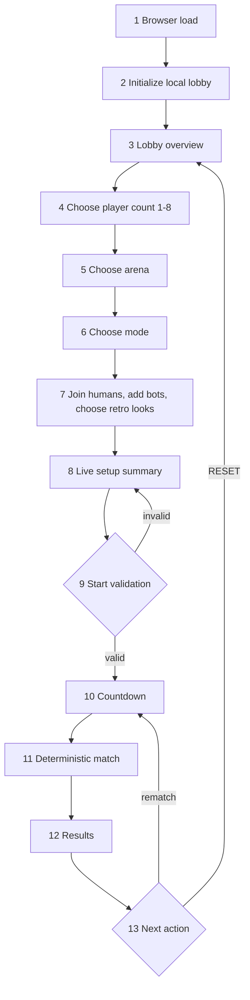

# TurenkiFight local menu and match flow

**Purpose:** shared reference for the complete browser path from loading the
game to returning after a match. This describes the current local retro flow;
online room creation remains a separate product path.

## Numbered path

1. **Browser load** — the player opens the game page and the app loads the
   station scene, retro textures, saved local choices and the selected arena.
2. **Local setup** — the presentation creates the initial local lobby with P1
   as the host; the simulation remains in `lobby` phase.
3. **Lobby overview** — the player sees arena, mode, player-count controls,
   slot controls, character selectors and the live setup summary.
4. **Player count** — choose 1–8 active slots. Slots above the count are
   inactive and cannot enter the match state.
5. **Arena** — choose station, K-kauppa or Mesku. The selected arena changes
   the presentation and local simulation setup; reload keeps the arena choice.
6. **Mode** — choose Score Brawl, Last Man Standing, Deathmatch or Wave.
7. **Roster and characters** — humans join through the supported keyboard or
   gamepad path; bots can be added or filled with ALL BOTS; active slots choose
   their retro appearance without changing their P1–P8 simulation identity.
8. **Setup summary** — the summary reports `ARENA · MODE · PLAYERS · HUMANS ·
   BOTS` from the actual current lobby state. Empty active slots are not
   invented as bots.
9. **Start validation** — normal one-slot matches are allowed only when the
   selected count is 1; other normal matches need two fighters. Wave needs at
   least one human and one bot enemy.
10. **Countdown** — the host starts the match; controls become match controls
    and the configured roster/mode/arena is passed to the match state.
11. **Fighting** — the deterministic fixed-step simulation runs, while Phaser
    renders the selected retro appearance and the HUD reports live state.
12. **Results** — the match ends in the mode-specific results view with the
    same stable player IDs and roster that started the match.
13. **Next action** — the host can rematch with the retained roster and mode,
    or RESET to return to the local lobby. A lobby reset clears joined players
    and bots back to P1 while keeping the selected local preferences.

## Flow diagram

## Ownership boundaries

- The lobby owns local presentation choices and roster preparation.
- The simulation owns fighters, teams, ticks, combat, scoring and results.
- Character selection is a slot-to-texture mapping, never a simulation field.
- Arena selection may affect local arena data, but presentation assets do not
  define collision geometry.
- The online room flow will reuse stable IDs and mode/state contracts later;
  it is not implied by this local diagram.

## Related implementation plans

- [Lobby selection](LOBBY_SELECTION.md)
- [L2 player count](LOBBY_L2_PLAYER_COUNT_PLAN.md)
- [L3 character selection](LOBBY_L3_CHARACTER_SELECT_PLAN.md)
- [L4 setup summary](LOBBY_L4_SUMMARY_PLAN.md)
- [Long-term product roadmap](LONG_TERM_PLAN.md)
