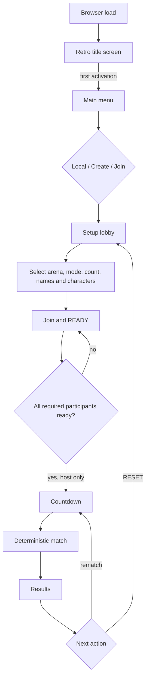

# TurenkiFight local menu and match flow

**Purpose:** shared reference for the browser path from loading the game to
returning after a match. This is the owner-approved target flow; implementation
is tracked in [GATE_G_ONBOARDING_FLOW.md](GATE_G_ONBOARDING_FLOW.md).

## Numbered path

1. **Browser load** — show the retro title/start screen and splash image, not a
   live match lobby. Reuse existing chiptune; browser audio starts after user
   activation.
2. **Main menu** — any user activation leaves the title screen for LOCAL FIGHT,
   CREATE ROOM and JOIN ROOM.
3. **Local setup** — entering LOCAL FIGHT opens the local lobby; P1 is host and
   player slots keep stable P1-P8 identities.
4. **Lobby overview** — show arena, mode, player-count controls, per-slot
   character and display-name selectors, join state, READY state and live
   setup summary.
5. **Player count** — choose 1–8 active slots. Slots above the count are
   inactive and cannot enter the match state.
6. **Arena** — choose station, K-kauppa or Mesku. The selected arena changes
   the presentation and local simulation setup; reload keeps the arena choice.
7. **Mode** — choose Score Brawl, Last Man Standing, Deathmatch or Wave.
8. **Roster and identity** — local humans join through keyboard/gamepad; each
   active slot has a display name and retro appearance while simulation keeps
   its P1-P8 ID. Bots may be used according to the selected mode.
9. **Readiness** — participating humans READY; only the host can start after
   all required human slots are ready. Proposed local rule: bot slots are
   automatically ready; unfilled required slots block start.
10. **Setup summary** — the summary reports `ARENA · MODE · PLAYERS · HUMANS ·
   BOTS` from the actual current lobby state. Empty active slots are not
   invented as bots.
11. **Start validation** — normal one-slot matches are allowed only when the
   selected count is 1; other normal matches need two fighters. Wave needs at
   least one human and one bot enemy.
12. **Countdown** — after the readiness barrier, the host starts the match;
    controls become match controls and the configured roster/mode/arena is
    passed to the match state.
13. **Fighting** — the deterministic fixed-step simulation runs; the HUD shows
   the chosen display name with a P-slot marker and selected retro appearance.
14. **Results** — the match ends in the mode-specific results view with
   display names while retaining stable IDs and the original roster.
15. **Next action** — the host can rematch with the retained roster and mode,
   or RESET to return to the local lobby. A lobby reset clears joined players
   and bots back to P1 while keeping the selected local preferences.

For online CREATE ROOM / JOIN ROOM, each joining connection chooses the name
and character for its own slot; the authoritative server publishes these
presentation values and READY state. The first participant remains the host.

## Flow diagram

## Ownership boundaries

- The lobby owns local presentation choices and roster preparation.
- The simulation owns fighters, teams, ticks, combat, scoring and results.
- Character selection is a slot-to-texture mapping, never a simulation field.
- Arena selection may affect local arena data, but presentation assets do not
  define collision geometry.
- Online names and character looks are room-scoped presentation metadata; the
  server owns READY and host-start eligibility, while simulation identity stays
  P1-P8.

## Related implementation plans

- [Lobby selection](LOBBY_SELECTION.md)
- [Gate G onboarding flow and task plan](GATE_G_ONBOARDING_FLOW.md)
- [L2 player count](LOBBY_L2_PLAYER_COUNT_PLAN.md)
- [L3 character selection](LOBBY_L3_CHARACTER_SELECT_PLAN.md)
- [L4 setup summary](LOBBY_L4_SUMMARY_PLAN.md)
- [Long-term product roadmap](LONG_TERM_PLAN.md)
