# M15 K-kauppa hazard UI evidence

Task: `M15-ARENA-HAZARD-UI`

## Visual review

The scene uses the shared global simulation tick. K-kauppa's rules resolve to idle through tick 2399, a 180-tick warning from 2400 through 2579, then the active shelf from tick 2580 through 2699. These are global ticks, including the 180-tick countdown. The first 1-HP damage tick is 2580; following damage follows the simulation's six-tick cadence.

The band remains marked while fighting, including before the warning. Before warning the ochre floor stripe and `SHELF ZONE` label are deliberately restrained; during warning the amber pulse and explicit seconds countdown are distinct; during collapse the red fill, border, hatching and `SHELF DROP` label are unmistakable. The label is outside the walkable x-range, so it does not cover the fighters. I inspected each capture in the table below: the band remains legible at both sizes and in both styles, while the four-player test also retains distinct fighters.

| Phase | Classic 640x360 | Classic 1280x720 | Retro 640x360 | Retro 1280x720 |
|---|---|---|---|---|
| Before warning | 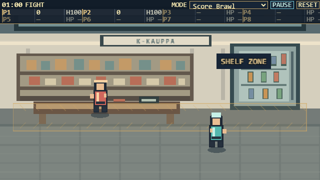 | 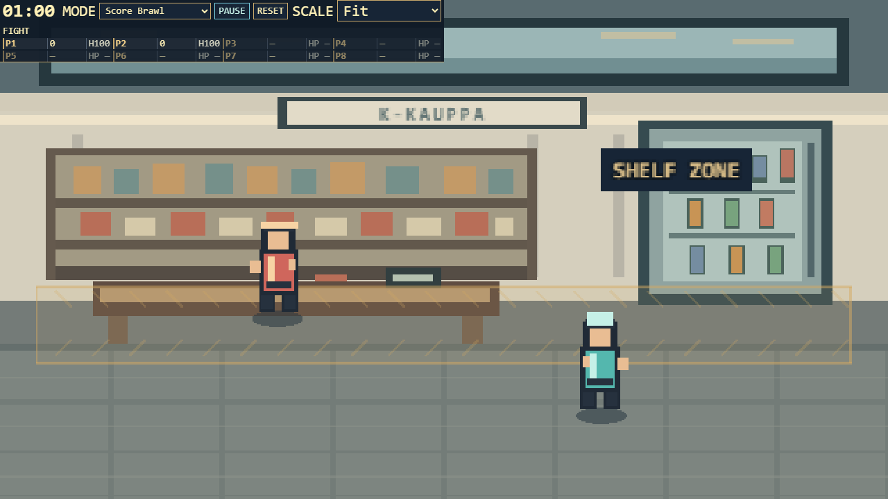 | 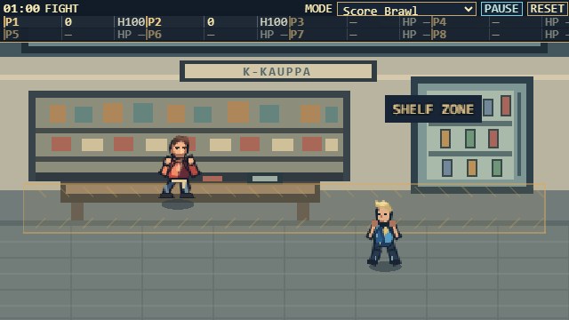 | 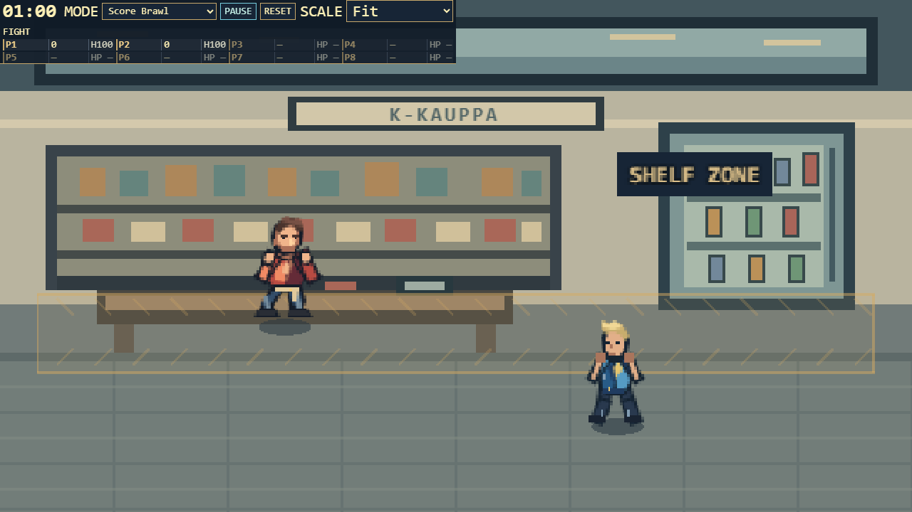 |
| Warning | 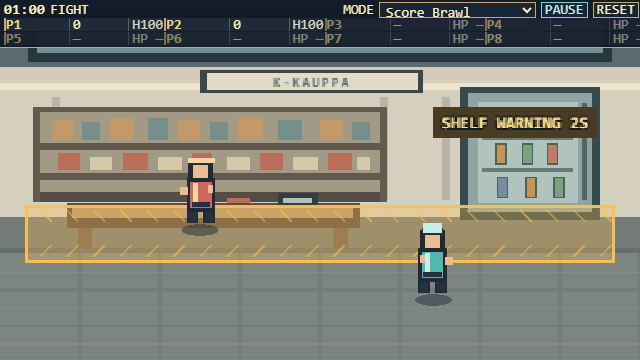 | 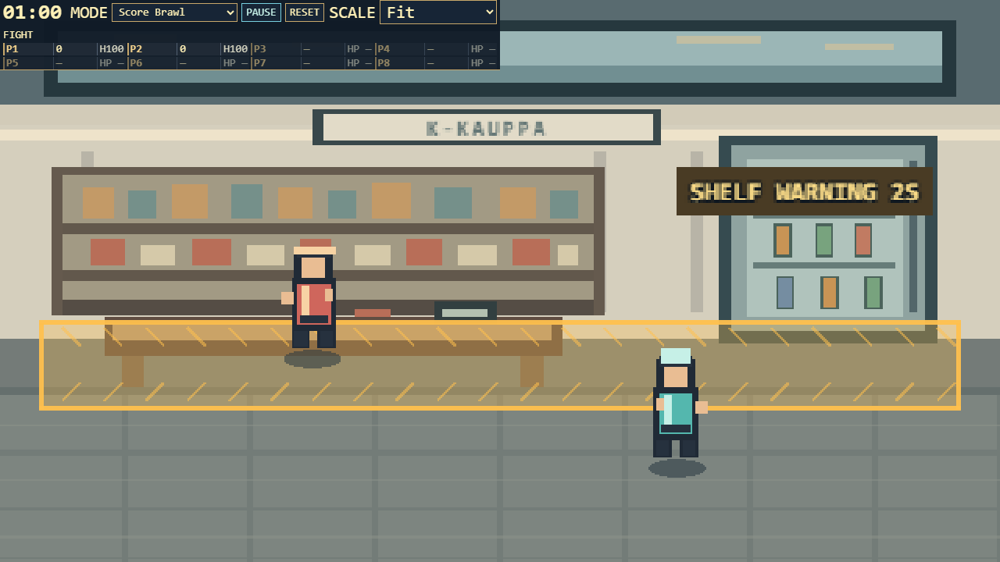 | 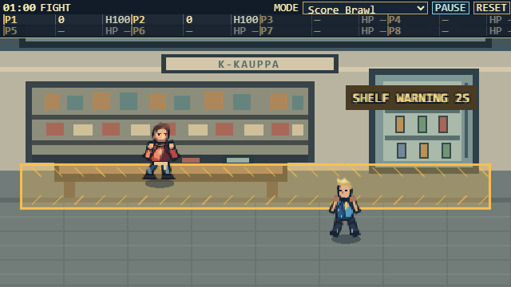 | 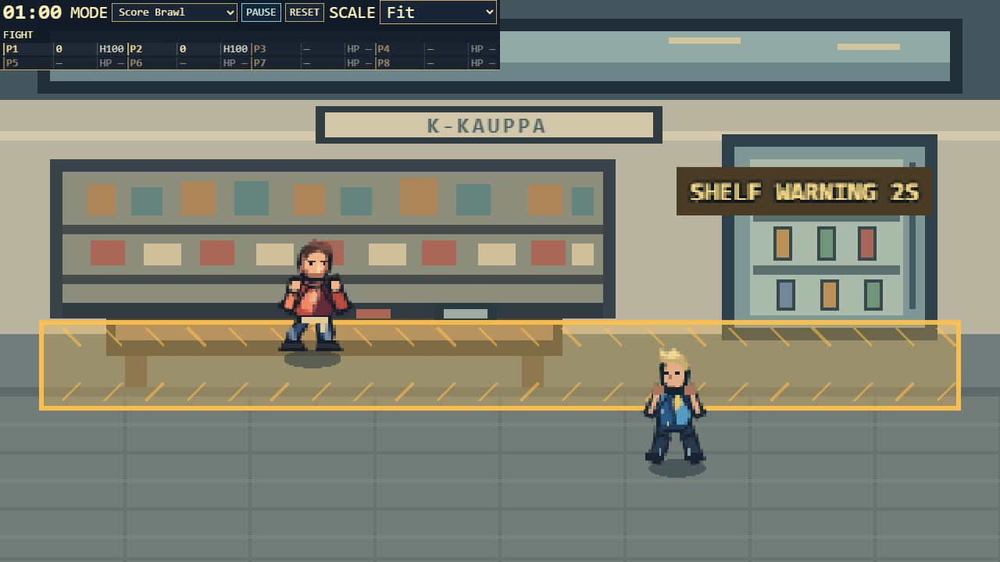 |
| Collapse | 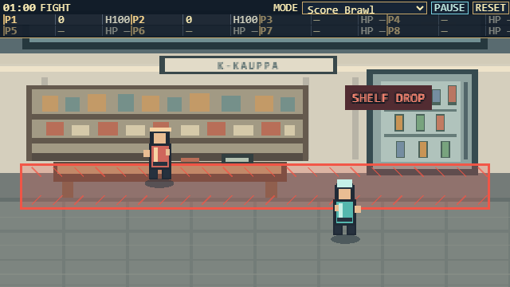 | 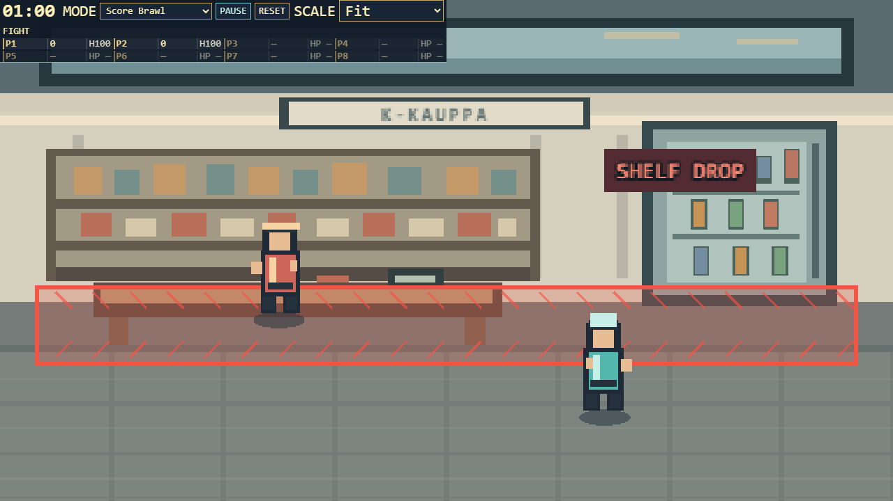 | 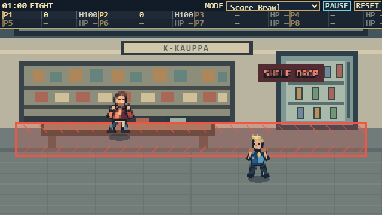 | 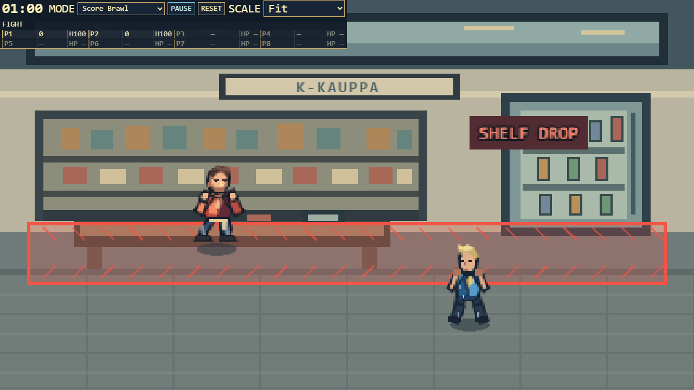 |

## Regression and fairness notes

- Station state creation compares byte-for-byte with the default `createState` setup and never draws the shelf band. Mesku retains its arena id only when that art selection resolves to Mesku; the classic fallback remains the station.
- Local arena health loss is driven only by `step()`. The edge tint and small camera shake are presentation feedback; reduced-motion suppresses the shake. Online presentation derives the band and warning only from `state.arena` and `state.tick`; an omitted server arena is treated as the station.
- Sparse online snapshots cannot reveal the fighter's exact y-position on every intervening damage tick. Damage feedback is inferred from health change, tick cadence and bracketing positions, so the edge flash can be missed or inferred in a rare crossing/combat overlap. It cannot change authoritative health or combat outcomes; the persistent band and warning remain the fairness cue.

## Screenshot files

All 12 captures are included beside this report: classic and retro, 640x360 and 1280x720, before warning / warning / collapse. They were taken from a paused scene fixture at exact canvas pixel dimensions.
